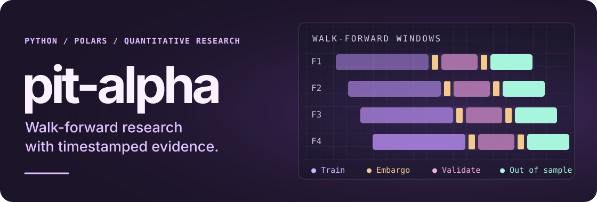

# pit-alpha

**Test your signal with the data you actually had.** A point-in-time factor research engine with purged walk-forward validation, fold-local fitting, and an auditable post-selection Sharpe check.

[Try the example](#quickstart) · [Data contract, CLI, and Python API](docs/PIT_ALPHA.md) · [Candidate benchmark, reports, and wheel](https://github.com/rishixgamer/pit-alpha/actions/runs/44683709466) · [Project site](https://rishixgamer.github.io/pit-alpha/)



## Quickstart

Python 3.12 · uv · Polars/Parquet input.

```sh
git clone https://github.com/rishixgamer/pit-alpha.git
cd pit-alpha
uv sync --frozen --all-groups
uv run pit-alpha example --directory ./example-run
uv run pit-alpha run --config ./example-run/example.yaml
```

The seeded example writes Markdown and JSON reports to `example-run/reports` with fold-by-fold metrics, regime breakdowns, and selection evidence.

## What you can do

- **Align.** Join Parquet observations by symbol and timestamp. Only revisions available at the decision time can enter features.
- **Validate.** Purge overlapping labels, enforce an embargo, and fit preprocessing and models inside each fold. A future-price canary exercises the full path.
- **Evaluate.** Inspect IC, Rank IC, ICIR, Sharpe, drawdown, turnover, and volatility regimes. Review the candidate search and adjusted holdout Sharpe check.

## Reproducible evidence

The v1.0.0rc1 reference run completed in **1.17 s at 156 MiB peak RSS** on Linux CI. It processed 5,784 rows per input table, 24 synthetic symbols, five trials, and five out-of-sample folds. The [candidate run](https://github.com/rishixgamer/pit-alpha/actions/runs/44683709466) includes the benchmark record, both reports, and install artifacts. See the [merge-commit CI](https://github.com/rishixgamer/pit-alpha/actions/runs/44684282673) and [Security run](https://github.com/rishixgamer/pit-alpha/actions/runs/44684282709) for verification of the merged implementation.

## QuantCheck research archive

`pit-alpha` grew out of QuantCheck. The day-level data audit remains available as `quantcheck`. The distribution is still `quantcheck` and exposes `asof_align`, `PurgedWalkForwardSplit`, and `evaluate_signals` under `quantcheck.pit_alpha`. See the [original audit quickstart, frozen benchmark, and evidence](docs/QUANTCHECK.md).

---

[v1.0 release candidate](docs/RELEASE_NOTES_1.0.md) · [MIT License](LICENSE) · [Issues](https://github.com/rishixgamer/pit-alpha/issues)

If pit-alpha helps your research, [star the repository](https://github.com/rishixgamer/pit-alpha).
